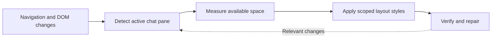

<div align="center">


# UltraWide ChatGPT

**More room to read. More space to work.**

A configurable Tampermonkey userscript that gives ChatGPT conversations more of your available screen space — without replacing the familiar interface.

[](./script.user.js)
[](https://github.com/jsmlabs/ultrawide-chatgpt/actions/workflows/userscript-validation.yml)
[](https://www.tampermonkey.net/)
[](./LICENSE)

**[Install latest GitHub source](https://raw.githubusercontent.com/jsmlabs/ultrawide-chatgpt/master/script.user.js)** · **[Install from Greasy Fork](https://greasyfork.org/en/scripts/557270-ultrawide-chatgpt)** · [View source](./script.user.js) · [Report an issue](https://github.com/jsmlabs/ultrawide-chatgpt/issues)

[Features](#-features) · [Installation](#-installation) · [Settings](#-settings) · [Troubleshooting](#-troubleshooting) · [Development](#-development)

</div>

> [!IMPORTANT]
> **GitHub and Greasy Fork are separate publication channels.** GitHub `master` currently contains **v2026.11.27.3**. Greasy Fork may have a different published version; check the version shown on its listing and in Tampermonkey before installing or updating. The GitHub userscript intentionally omits `@updateURL` and `@downloadURL`, so GitHub-source installations must be updated manually.

## ✨ Features

| | Feature | What you get |
| :---: | --- | --- |
| ↔️ | **Wider conversations** | Use your available chat-pane width, with optional limits from **1,200–4,200 px** or no fixed cap. |
| 📐 | **Adaptive layout** | Account for the active pane, sidebar changes, browser zoom, and constrained windows. |
| ✍️ | **Independent composer sizing** | Widen the message composer separately; avoid unrelated editors and dialogs. |
| 🪟 | **Chat, Work & split views** | Apply pane-aware positioning and cautious layout handling where supported. |
| 📄 | **Content overflow safeguards** | Keep long code, tables, and rich media within their appropriate scrolling or layout boundaries where possible. |
| 🔄 | **Automatic recovery** | Reconcile layout after supported navigation, DOM remounts, and pane-size changes, with bounded repair attempts. |
| ⚡ | **Low-power defaults** | Debounce DOM work, reduce periodic activity, and pause selected work in background tabs. |
| 🩺 | **Diagnostics & recovery tools** | Inspect runtime health, verify layout, request repairs, and export troubleshooting reports. |

UltraWide changes **layout**, not ChatGPT's underlying models or features. The goal is to make an existing conversation workspace easier to use on larger screens while preserving native interactions.

### How adaptive width works

With the defaults, widening is eligible when the **effective chat pane** is at least **1,100 CSS pixels** wide and the window is at least **560 px** high. Horizontal gutters vary between **16 and 36 px**. In narrower panes or split views, the script may deliberately retain a more native layout rather than force an oversized one.

## 🚀 Installation

**Requirements:** A modern browser with [Tampermonkey](https://www.tampermonkey.net/), access to [ChatGPT](https://chatgpt.com/), and the userscript's declared permissions. The script targets `chatgpt.com` and `www.chatgpt.com`.

1. Install and enable **Tampermonkey** in your browser.
2. Pick **one** installation source:
   - **[Latest GitHub source](https://raw.githubusercontent.com/jsmlabs/ultrawide-chatgpt/master/script.user.js)** — newer repository build; manually update when needed.
   - **[Greasy Fork](https://greasyfork.org/en/scripts/557270-ultrawide-chatgpt)** — separately published version; check its displayed version before installing.
3. Approve the userscript installation. If your manager opens the GitHub link as plain text, copy the complete [`script.user.js`](./script.user.js) source into a new Tampermonkey script, including its metadata header.
4. Refresh **[chatgpt.com](https://chatgpt.com/)**. Press **`Alt+S`** outside the message editor to open UltraWide settings, or use the Tampermonkey menu.

> [!TIP]
> **Already installed?** Update or replace your existing UltraWide script instead of enabling two copies. Refresh ChatGPT afterwards. Settings are stored under `uwc.settings.v14`, with migrations for older keys.

**Disable or uninstall:** Press `Alt+O` to toggle the script's layout behavior, disable it in Tampermonkey, or uninstall it in your userscript manager. Removing the script does not necessarily delete saved userscript settings.

## 🎛️ Settings

Open the built-in settings dialog with **`Alt+S`** or the **UltraWide ChatGPT** Tampermonkey menu.

| Control | Default | Description |
| --- | :---: | --- |
| UltraWide layout | On | Enable the main width adjustments. |
| Content alignment | Left | Left-align managed conversation content. |
| Maximum width | None | No fixed cap, or choose a preset. |
| Adaptive sizing | On | Use actual pane and viewport conditions. |
| Minimum pane width | 1,100 px | Threshold for adaptive widening. |
| Minimum window height | 560 px | Keep a safer layout in short windows. |
| Composer widening | On | Control composer width independently. |
| Media safeguards | On | Reduce avoidable content overflow. |
| Split-view safe mode | On | Be conservative when adjacent panels are detected. |
| Low-power mode | On | Reduce routine background work. |
| Pause when hidden | On | Defer selected background checks in hidden tabs. |
| Debug overlay | Off | Show on-page diagnostic information. |

**Width presets:** `none`, `1200`, `1400`, `1600`, `1800`, `2000`, `2200`, `2400`, `2800`, `3200`, `3600`, `4200`. These configuration values are **strings**, not numbers.

<details>
<summary><strong>Advanced configuration and exact defaults</strong></summary>

| Setting | Default | Purpose |
| --- | --- | --- |
| `enabled` / `wide` | `true` / `true` | Master enable and widening controls |
| `left` | `true` | Conversation alignment |
| `cap` | `'none'` | Width cap string |
| `auto` / `autoMinWidth` | `true` / `1100` | Pane-aware adaptive sizing |
| `disableOnTouch` | `false` | Optionally avoid adaptive sizing on touch devices |
| `disableBelowHeight` | `560` | Minimum window height; `0` disables the threshold |
| `gutterMin` / `gutterVw` / `gutterMax` | `16` / `2` / `36` | Responsive horizontal gutters |
| `widenComposer` / `safeMedia` | `true` / `true` | Composer and content safeguards |
| `canvasSafeMode` | `true` | Split-view-aware layout |
| `lowPowerMode` / `pauseWhenHidden` | `true` / `true` | Background performance behavior |
| `performanceTelemetry` | `true` | Local performance measurements |
| `debugOverlay` | `false` | On-page runtime diagnostics |
| `toast` / `toastMs` | `true` / `1500` | Notifications and duration in milliseconds |
| `closeSettingsOnBackdrop` | `true` | Close dialog by clicking the backdrop |
| `scanDebounceMs` | `240` | Structural scan debounce in milliseconds |
| `repairIntervalMs` | `10000` | Base repair interval in milliseconds |
| `routePollMs` | `10000` | Base route-check interval in milliseconds |

With low-power mode on, effective scan debounce is at least **550 ms**, and routine repair and route intervals are at least **30 seconds**. Actual runtime values are exposed through `window.__mlUltraWide.state()` when the page-console bridge is available.

</details>

### Keyboard shortcuts

Shortcuts are ignored in recognized typing fields. Some browser or extension bindings may take precedence.

| Shortcut | Action | Shortcut | Action |
| --- | --- | --- | --- |
| `Alt+S` | Open settings | `Alt+O` | Enable / disable layout |
| `Alt+U` | Toggle wide mode | `Alt+L` | Toggle left alignment |
| `Alt+M` | Cycle width caps | `Alt+A` | Toggle adaptive mode |
| `Alt+C` | Toggle split-view safe mode | `Alt+R` | Reset settings |

> [!CAUTION]
> Saving some settings can trigger a guarded page reload. Preserve any unfinished ChatGPT draft before changing settings.

## 🛠️ Troubleshooting

| Symptom | What to check |
| --- | --- |
| Chat still looks narrow | Confirm only one enabled copy, verify `enabled` / `wide`, check the effective pane width and adaptive threshold, then refresh. |
| Conversation becomes cramped | Try a smaller width cap or leave adaptive sizing and split-view safe mode enabled. |
| Composer remains narrow | Check `widenComposer`; Work may use a separate, intentionally sized composer. |
| Tables or code overflow | Keep `safeMedia` enabled. A real horizontal scroller inside a table or code widget may be intentional. |
| A scrollbar appears near `@` suggestions | Check whether it belongs to a genuine scrollable region. The script aims to avoid hiding functional scrollbars. |
| Layout changes after navigation | Use the settings-menu repair action or run `window.__mlUltraWide.repair()` if accessible. |
| High background activity | Enable `lowPowerMode` and `pauseWhenHidden`; turn off the debug overlay. |
| Keyboard shortcut does nothing | Move focus outside inputs, then check conflicting browser or extension shortcuts. |
| Settings are not saved | Check Tampermonkey storage permissions and `state().storageAvailable`. |
| Console API is undefined | Check the active script, browser permissions, and console execution context. Some userscript sandboxes block access to page globals; use the Tampermonkey menu instead. |

**For help:** [Open a GitHub issue](https://github.com/jsmlabs/ultrawide-chatgpt/issues/new) with the script version, browser, Tampermonkey version, ChatGPT view, reproduction steps, expected versus actual behavior, and screenshots or **redacted** diagnostics.

> [!WARNING]
> Diagnostics can include page URLs, browser information, layout indicators, settings, and recent runtime events. Inspect and redact them before sharing. Never publish conversation content, private URLs, or credentials.

## 🧩 Diagnostics and recovery

If the page-console bridge is available, open DevTools on the ChatGPT tab:

```js
const uwc = window.__mlUltraWide;

// Read-only inspection
uwc.state();
uwc.verify();
uwc.health();
uwc.diagnostics();

// Configuration — cap values must be strings
uwc.set({ cap: '2400', auto: true, widenComposer: false });

// Recovery
uwc.repair();
uwc.reset();
```

<details>
<summary><strong>Additional runtime commands</strong></summary>

| Task | Methods |
| --- | --- |
| Inspect | `capabilities()`, `selectorHealth()`, `invariants()`, `healthBreakdown()`, `performanceBudget()`, `composerOverflow()` |
| Layout lifecycle | `apply()`, `scan()`, `reconcile()`, `start()`, `stop()`, `restart()` |
| Recovery | `repairPlan()`, `repairHistory()`, `repairEffectiveness()`, `clearSafeFallback()` |
| Settings | `set({...})`, `reset()`, `caps()`, `openSettings()`, `closeSettings()` |
| Reports | `copyDiagnostics()`, `downloadDiagnostics()`, `downloadBugReport()` |
| Self-tests | `selfTest()`, `regressionTest()`, `lifecycleTortureSelfTest()` |

**Note:** Some methods change runtime state; `lifecycleTortureSelfTest()` deliberately stops and restarts the script. The console API is exposed through `unsafeWindow` when permitted. A userscript isolation boundary or Content Security Policy can still prevent direct console access.

</details>

## 🔒 Privacy and compatibility

- **Local operation:** UltraWide runs in your browser and does not require a separate backend or account.
- **Storage:** Preferences use Tampermonkey's `GM_getValue` / `GM_setValue` storage; optional performance diagnostics are collected locally.
- **Permissions:** The source declares storage, userscript-menu, and `unsafeWindow` permissions; no `@require` or outbound request grant is declared.
- **Scope:** The project targets ChatGPT's website. It does not provide an official ChatGPT integration.
- **Limitations:** ChatGPT's UI evolves. DOM-based layout detection cannot guarantee correct behavior across every browser, account, zoom level, Work view, or future interface revision.

**ChatGPT icon:** The userscript and README use the original [OpenAI SVG icon](https://cdn.jsdelivr.net/gh/simple-icons/simple-icons/icons/openai.svg) from Simple Icons. The former custom PNG remains in the repository for historical compatibility.

## 🧪 Development

**No build step or application runtime dependencies are required.** `script.user.js` is a standalone userscript. Node.js is used for optional local syntax and regression checks.

```bash
git clone https://github.com/jsmlabs/ultrawide-chatgpt.git
cd ultrawide-chatgpt
node --check script.user.js
node --test tests/*.test.cjs
```

The [GitHub Actions workflow](./.github/workflows/userscript-validation.yml) runs these checks on pull requests and pushes to `master`. Tests cover isolated layout, integration, and scroll-regression contracts. **A passing syntax or Node test does not establish live browser, Tampermonkey, Work, or production ChatGPT compatibility.** Manual browser validation is still necessary for navigation, long conversations, pane resizing, tables, `@` menus, and enable/disable cleanup.

<details>
<summary><strong>Architecture and project files</strong></summary>



The script uses scoped style rules, structural detection, lifecycle cleanup, and bounded DOM observation. Detection and recovery are heuristic rather than a guarantee against future UI changes.

| File | Purpose |
| --- | --- |
| [`script.user.js`](./script.user.js) | Userscript, settings, runtime, and diagnostics |
| [`tests/`](./tests) | Isolated Node regression tests |
| [`CHANGELOG.md`](./CHANGELOG.md) | Chronological changes |
| [`LICENSE`](./LICENSE) | Distribution terms |
| [`CONTRIBUTING.md`](./CONTRIBUTING.md) | Contribution checklist and verification |
| [`SECURITY.md`](./SECURITY.md) | Vulnerability reporting and privacy |

</details>

## 🤝 Community and contributions

Thanks to **[petrt3522](https://greasyfork.org/scripts/557270-ultrawide-chatgpt/discussions/342892)** for investigating pane sizing, browser zoom, Work alignment, and clipping behavior, and for sharing improvements subsequently adapted and integrated in **[PR #4](https://github.com/jsmlabs/ultrawide-chatgpt/pull/4)**. The community [Work table follow-up](https://greasyfork.org/scripts/557270-ultrawide-chatgpt/discussions/344206) is also acknowledged.

For reporting and review expectations, see [CONTRIBUTING.md](./CONTRIBUTING.md) and [SECURITY.md](./SECURITY.md). Bug reports and focused contributions are welcome through [GitHub Issues](https://github.com/jsmlabs/ultrawide-chatgpt/issues) and pull requests. Keep changes scoped, preserve existing settings and cleanup behavior, and include executable regression coverage where practical. Historical contributor notices and applicable earlier grants must be respected.

## 📄 License

Copyright © 2026 JSM. Maintained by **jsmdev**.

Distributed under the **[JSM Custom License v1.1](./LICENSE)**. This is a **custom source-available license, not an OSI-approved open-source license**. It permits specified use, modification, redistribution, and commercial integration subject to conditions including attribution; resale of substantially unchanged standalone copies is restricted. Read the complete license before redistribution or commercial use.

UltraWide ChatGPT is an independent project and is **not affiliated with, sponsored by, or endorsed by OpenAI**. ChatGPT is a trademark of its respective owner.

---

<div align="center">

**Make better use of the space you already have.**

[Latest GitHub script](https://raw.githubusercontent.com/jsmlabs/ultrawide-chatgpt/master/script.user.js) · [Greasy Fork](https://greasyfork.org/en/scripts/557270-ultrawide-chatgpt) · [Changelog](./CHANGELOG.md) · [Support](https://github.com/jsmlabs/ultrawide-chatgpt/issues)

</div>
